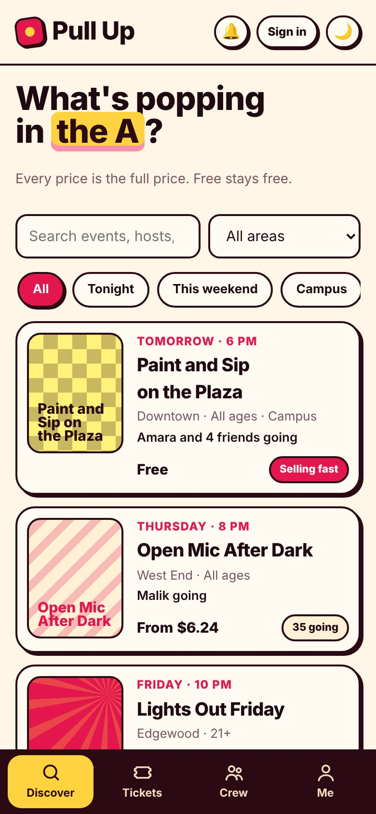
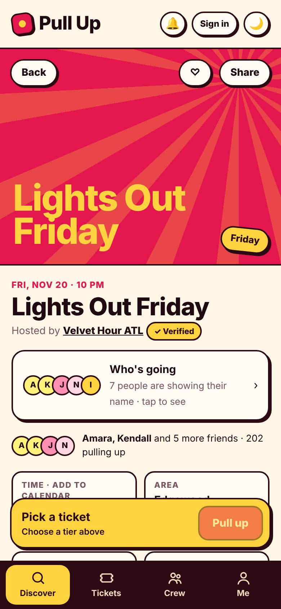
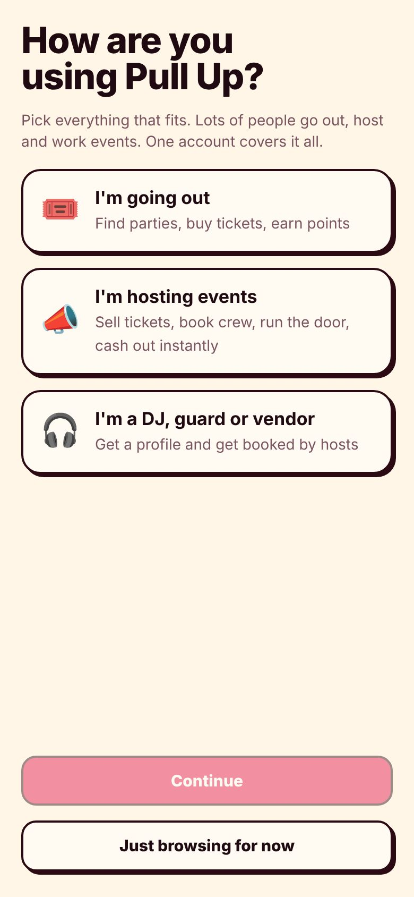
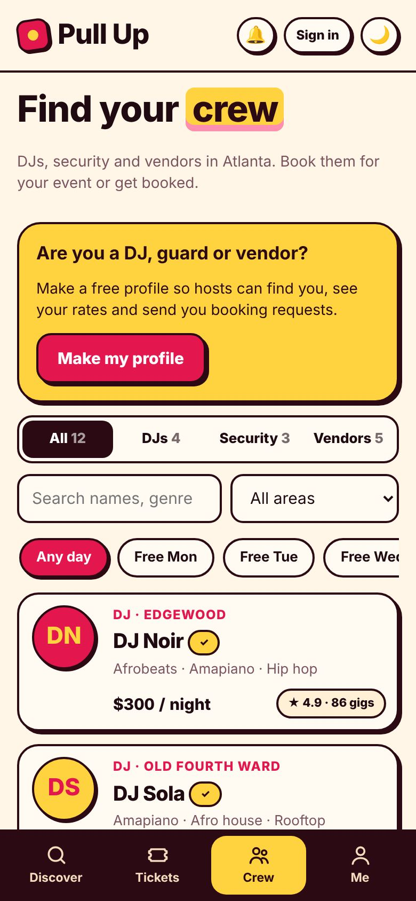

# Pull Up

**Event ticketing for Atlanta**

**Live demo:** https://pullupticketing.netlify.app  
**Status:** In progress · **Built at:** Personal

   

## Overview
An event ticketing app starting in Atlanta, where one account covers going out, hosting and working events as a DJ, guard or vendor. The launch goal is New Year’s Eve 2026.

## What I built
Discovery for parties, day parties, open mics and kickbacks filtered by tonight, your area and your age; tickets you can transfer; group buys; a promoter leaderboard; door sales and comp tickets; crew booking with set times; organizer pages, payouts and cash out; and a profile switcher between guest, host and crew. Payments are planned through Stripe.

## My role
Solo project: research, UX flows, design and build.

## Security and privacy
* Payments are planned through Stripe so card data never touches the app.
* Ticket door codes and addresses only unlock on the purchased ticket.

## Tech
HTML, CSS, JavaScript, Claude, Stripe (planned)

## Run it
It is a static site: open `index.html` in a browser, or drag the folder onto Netlify Drop or Vercel. Deploy notes are in [SETUP.md](SETUP.md).

## What's next
Connect Stripe, run the first real event through it, and compare it against PeerPop, Posh and Eventbrite.

---
Built by **Taseyana Booker-Hopkins** · Computer Information Systems (cybersecurity), Georgia State University · [Portfolio](https://taseyanab.github.io) · [LinkedIn](https://linkedin.com/in/taseyana)
